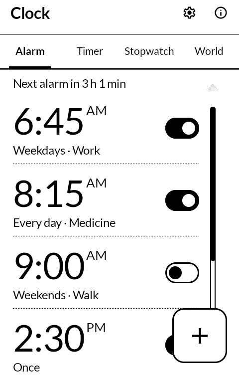
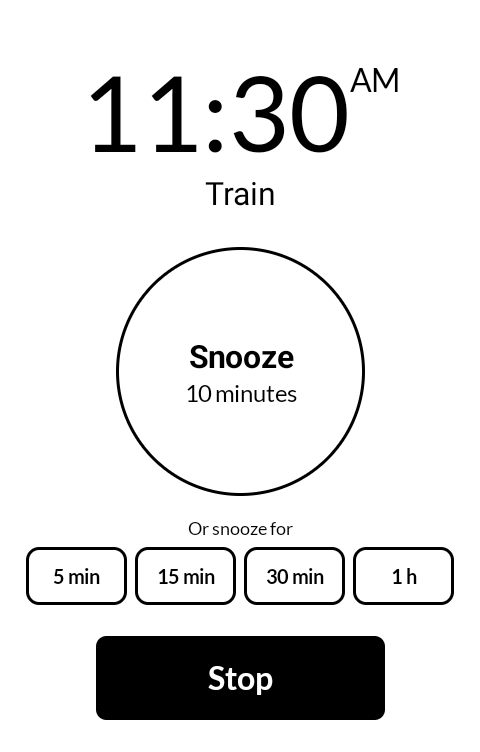
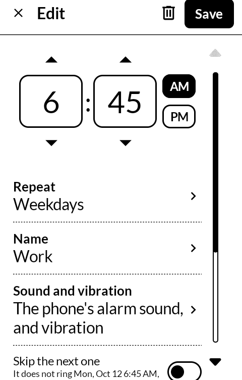
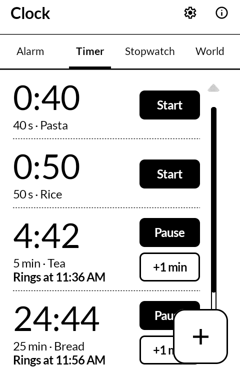
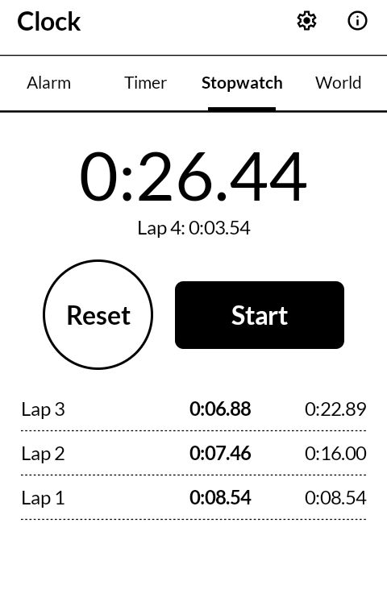
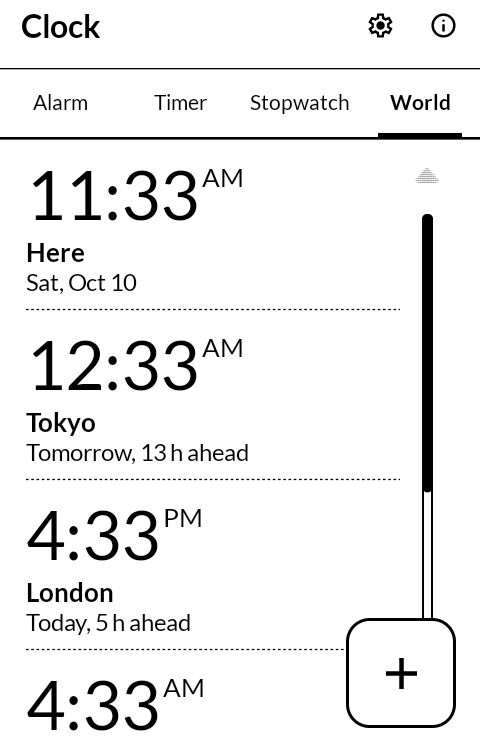

# 時計 tokei — Clock

Alarms, timers, a stopwatch and a world clock for the
[Mudita Kompakt](https://mudita.com/products/kompakt/), laid out like the phone's own Alarm app
and built with Mudita's [MMD](https://github.com/mudita/MMD) design system. It installs on any
Android 12 device.

*Tokei* is 時計 — a clock, the plain word for one.

| | |
|---|---|
|  |  |
|  |  |
|  |  |

## What it does

- **Alarms, as many as you like.** Each has its time, the days it repeats on (or once), a name,
  a sound and vibration, and a switch. The time is typed on the number keys, or stepped with the
  arrows, to the minute.
- **Snooze for as long as you choose, on the ringing screen.** The round Snooze button puts it
  off for the length set in Settings (10 minutes to start with); under it, 5, 15 and 30 minutes
  and 1 hour each snooze for that long at a press.
- **Rings until it is answered**, on the alarm volume, so a phone set to silent still rings. If
  nobody answers it stops after 10 minutes (5, 15 or 30 can be chosen, or 1) and is listed as
  missed. It can start quiet and grow to full volume over a minute.
- **The sound** is the phone's own alarm sound, any of its other alarm sounds, a sound file of
  your own, or none, to vibrate only. Vibration is on or off for each alarm.
- **Skip the next one** of a repeating alarm, for a day off, without switching it off.
- **Timers that ring.** As many as you like, each kept with its length and name to start again,
  and several can run at once. When one reaches zero it rings like an alarm, with the screen off
  or the phone locked, until it is stopped or given a minute more.
- **A stopwatch** with laps. It keeps counting with the app closed.
- **A world clock** for the cities you choose, each with its day and how far ahead or behind.
- **Never misses an alarm without saying so.** If an alarm or a timer could not ring — the app
  was stopped, the phone was off — the first screen and a notification say which one, when, and
  why, as far as the phone can tell: "10:53, Stopped: the app was stopped, so it could not ring".

## Ringing on time on a Kompakt

On the Kompakt forum, alarms that rang minutes late or not at all after a night asleep were
mended by two settings. Clock's first screen asks for each, only while it is needed:

- **DuraSpeed** shuts apps down a few minutes after the screen goes dark, and an app shut down
  that way has its alarms cancelled. Press **Open DuraSpeed**, tap **Open** there, switch Clock
  on, then press **It's switched on**. If DuraSpeed stops the app again, the step comes back.
- **Battery saving** can hold an app back, so an alarm rings minutes late. Press **Allow** and
  let Clock run without restriction.

Alarms are set as the system's alarm clock, the kind that wakes the phone at the exact minute
whatever it is saving power for; the phone's alarm icon and Mudita's home screen show the next
one. They are set again after a restart, after the app is updated, and when the clock or the
time zone changes: 06:30 stays 06:30 local time after a flight. On the night the clocks go
forward a time that does not exist rings when the clock comes back; on the night they go back,
a time that happens twice rings once.

During a call an alarm rings quietly and vibrates, and the ringing screen still comes up.

## Using it in place of the stock clock

Clock answers what Android's own clock answers, so most ways of reaching "the clock" can be
pointed at it. What it can and cannot take over, as found on a Kompakt (MuditaOS with Mudita
Launcher 1.5.0, inkOS 0.6):

| Where | What it opens now | Can Clock take it? | How |
|---|---|---|---|
| Mudita's home screen, tapping the time | The stock Alarm app (`com.mudita.alarm`), by name | No | The launcher opens that one app and no other. Hiding the stock app makes the tap do nothing; it does not open Clock. |
| Mudita's home screen, the next-alarm line | Whatever alarm is set next, from the system | Already does | Clock's alarms show there; a snoozed one shows as snoozed. |
| inkOS, tapping the clock | An app picked in inkOS, or else whatever Android uses to show alarms | Yes | In inkOS settings, set the clock tap to open Clock. Left unset, Android asks which app to use, unless one was chosen with **Always** before: pick Clock, then **Always**. |
| The status bar's alarm icon and the next alarm on the lock screen | The app that set the alarm | Already does | Clock's alarms open Clock. |
| Other apps setting an alarm or a timer ("set an alarm for 6:30") | Android's clock (`com.android.deskclock`) until another app answers | Yes | The first time, Android asks which app: pick Clock, then **Always**. |
| Glance | The app that wrote the line | Yes | Turn on **Next alarm on the lock screen** in Clock's settings, and Clock in Glance. |
| Katapult | Nothing: its clock is for reading | — | — |

Both stock clocks can stay installed. Hiding them (from a computer, with
`adb shell pm disable-user --user 0 com.mudita.alarm`, and the same for `com.android.deskclock`;
`pm enable` brings them back) stops their alarms from ringing too, so move any alarms over
first. With the stock Alarm app hidden, the time on Mudita's home screen no longer opens
anything.

## For other apps

Clock answers the standard `android.provider.AlarmClock` actions: `SET_ALARM` (hour, minutes,
message, days, ringtone, vibrate, skip UI), `SHOW_ALARMS`, `SNOOZE_ALARM`, `DISMISS_ALARM`,
`SET_TIMER` (length, message, skip UI), `SHOW_TIMERS` and `DISMISS_TIMER`; and the stopwatch
and clock actions Android's own clock takes by name (`com.android.deskclock.action.SHOW_STOPWATCH`,
`START_STOPWATCH`, `PAUSE_STOPWATCH`, `LAP_STOPWATCH`, `RESET_STOPWATCH`, `SHOW_TIMERS`,
`SHOW_CLOCK`). Those that change anything need the `com.android.alarm.permission.SET_ALARM`
permission, as with Android's clock.

## With the other apps

- **Glance** ([hitome](https://github.com/wanderwildwood/hitome)) can show the next alarm, and
  any timer running, on the lock screen, once **Settings → Next alarm on the lock screen** is on.

## What it does not do

- **Nothing leaves the phone.** The app has no internet permission.
- **No widgets, no bedtime tracking, no alarms by the month.** Not in this version.

## Building

```
./gradlew assembleDebug
```

A release build needs a keystore at `signing/signing.keystore` with a matching
`signing/signing.properties`. There is no fallback key in this repository: without one, a
release build comes out unsigned rather than wrongly signed.

## Licence

GPL-3.0-only. See [LICENSE](LICENSE).

Copyright (C) 2026 wander wildwood

This program is free software: you can redistribute it and/or modify it under the terms of the
GNU General Public License as published by the Free Software Foundation, version 3.

This program is distributed in the hope that it will be useful, but WITHOUT ANY WARRANTY;
without even the implied warranty of MERCHANTABILITY or FITNESS FOR A PARTICULAR PURPOSE. See
the GNU General Public License for more details.

You should have received a copy of the GNU General Public License along with this program. If
not, see <https://www.gnu.org/licenses/>.

Icons are from Material Symbols, Apache 2.0.

## Where it comes from

Clock began as a fork of [Fossify Clock](https://github.com/FossifyOrg/Clock) (GPL-3.0), and its
history is kept in this repository. From it come the alarm and timer models, the arithmetic of
repeat days, the stopwatch's laps, the list of world-clock cities, and the way the ringing sound
loops on the alarm volume. Its screens and its shared library were replaced: the screens are
Mudita's MMD, laid out after the Kompakt's own Alarm app, and the part that sets alarms and
rings them is the one from [Medicine](https://github.com/wanderwildwood/fukuyaku), which keeps
a record of anything that did not ring.
